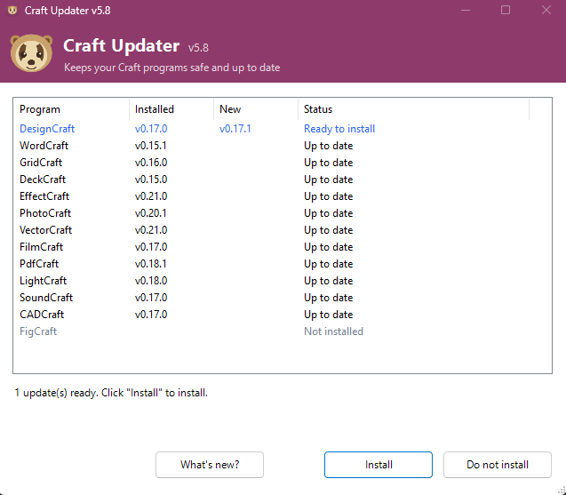
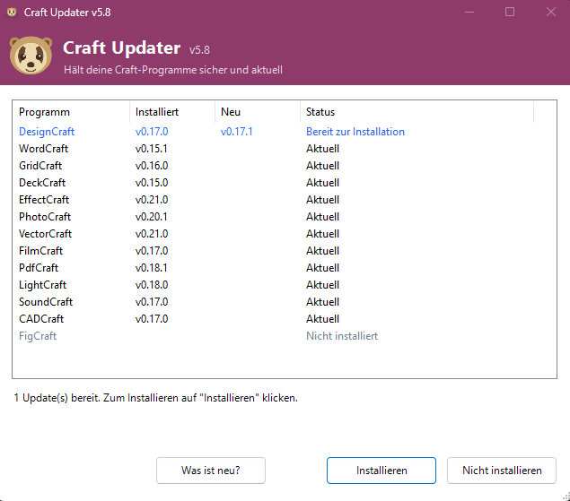

# Craft Updater

**Craft Updater does one thing: it keeps the Craft apps you already have up to date – all at once, and only after checking every installer thoroughly.**

[](https://github.com/slothmade/craft-updater/actions/workflows/tests.yml)
[](LICENSE)

A small, careful Windows updater for the **Craft** desktop apps: WordCraft, GridCraft, DeckCraft, EffectCraft, DesignCraft, PhotoCraft, VectorCraft, FilmCraft, PdfCraft, LightCraft, FigCraft, SoundCraft, CADCraft, TextureCraft and MaterialCraft.

It checks the official GitHub releases, downloads only properly signed installers, verifies them thoroughly and installs updates **only after you approve them**.

> **Unofficial project.** Craft Updater is not made by, affiliated with or endorsed by the developers of the Craft apps. All product names belong to their respective owners.

*Deutsch: Das Programm spricht auf einem deutschen Windows automatisch Deutsch. Eine deutsche Anleitung liegt im Paket unter [`ANLEITUNG.txt`](Craft-Updater-v5.9-Portable/ANLEITUNG.txt).*

<p align="center">
  
  
</p>

## Quick start

1. Download `Craft-Updater-v5.9-Portable.zip` from the [latest release](../../releases/latest) and extract the folder, for example to your desktop.
2. Double-click `Craft-Updater-STARTEN.cmd` and allow administrator rights.
3. If updates are available, click **Install** and confirm with **Yes**.

That's it. Nothing is installed on your PC except the Craft updates you approve.

## What it does

- **Updates only what you already have.** Programs that are not installed are skipped.
- **Checks every update before installing it:** SHA-256, Windows code signature, publisher, certificate profile, MSI contents and the upgrade relationship to your installed version. Details in [SECURITY.md](SECURITY.md).
- **Fails closed.** If one installer fails a security check, nothing at all is installed in that run.
- **Locks the checked file** until Windows Installer has finished, so it cannot be swapped in between.
- **Shows what's new** in each update before you decide: click a program in the list and then *What's new?*, or double-click the program.
- **Asks once, clearly.** *Install* button plus *Yes*, or `YES` (German: `JA`) in console mode.
- **Verifies afterwards** that the new version is really installed.
- **Tells you about a new Craft Updater version** with a small link at the bottom right of the window. A click lets you open the release page, skip this version (the notice comes back only for an even newer one) or decide later; nothing is downloaded or installed automatically.
- **Leaves a shareable report** when something goes wrong, in the folder *Error reports* (German: *Fehlermeldung*). Your user name and computer name are removed from it.
- **Speaks German or English**, depending on your Windows language (override with `CRAFT_UPDATER_LANG=de` or `en`).

## Other ways to update Craft apps

Craft Updater is not the only option. As of November 2026 there are, for example:

- **The built-in update of each Craft app** (official) – every app can update itself; on Windows it checks the checksum and that the new installer is signed by the same publisher as the installed app.
- **[ArtCraft Launcher](https://github.com/storytold/craft-launcher)** (official, in early alpha according to its README) – installs, updates, opens and removes all Craft apps, can go back to older versions and shows release notes, on Windows, macOS, Linux and FreeBSD.
- **[Craft Apps Manager](https://github.com/CryptoKey98/craft-apps-manager)** (community) – installs, updates, rolls back and builds Craft apps, with many options.
- **[ArtCraft Suite Updater](https://github.com/Lyraedan/ArtCraft-Suit-Updater)** (community) – a desktop app that lists, downloads and installs the Craft apps on Windows, macOS and Linux.
- **[StoryTold Installer](https://github.com/liviobelegante/StoryTold-Installer)** (community) – installs selected Craft apps from their official installers on Windows and can build some of them from source.
- **[Install-Update-ArtCraftApps](https://github.com/aangelis/Install-Update-ArtCraftApps)** (community) – a single PowerShell script that installs and updates the whole suite without interaction.
- **winget** – several Craft apps are available in the Windows Package Manager.

All of them are fine choices, and several offer more features than Craft Updater.

### What Craft Updater does differently

Craft Updater is deliberately small. It only updates apps you already have, and it puts every installer through a few more checks than we found in the other Craft tools when we read their public source code in November 2026 (winget is a general package manager and not part of this comparison). These tools keep improving, so this may change. Craft Updater checks:

- SHA-256 checksum **and** Windows code signature **and** publisher – plus the exact certificate profile (EKU) and the certificate issuer
- MSI contents compared with the release: product name, version, manufacturer and processor architecture
- the MSI upgrade table has to match your installed version and language
- all checks run again right before installing, and the file stays locked until Windows Installer has finished
- **one** failed security check stops the **whole** run – nothing is installed
- nothing is installed without your *Install* + *Yes*

Why the signature check matters: a SHA-256 checksum is published together with the file, or copied from the same release. If a release were ever tampered with, the checksum could match the tampered file too. The code signature with the expected publisher and certificate profile is an independent second lock.

### Craft Updater or ArtCraft Launcher?

Craft Updater is meant as an **addition**, not a replacement. An honest comparison with the official [ArtCraft Launcher](https://github.com/storytold/craft-launcher), based on its public source code from 5 November 2026:

| | Craft Updater | ArtCraft Launcher |
|---|---|---|
| Made by | a hobbyist (unofficial) | the ArtCraft team (official) |
| Systems | Windows | Windows, macOS, Linux, FreeBSD |
| Updates installed apps | yes | yes |
| Installs new apps | not yet (planned) | yes |
| Opens and uninstalls the apps | no | yes |
| Go back to an older version | no | yes |
| Shows what's new | yes | yes |
| New Craft apps | added with a Craft Updater release | added by the ArtCraft team, also community apps |
| Languages | German, English | many |
| Checks before installing on Windows | checksum, code signature, publisher, certificate profile, MSI contents, upgrade table – all checked again right before installing (see above) | checksum from the release (installers without one are refused); Windows itself shows the publisher when it asks for permission |
| Needs to be installed itself | no (portable folder) | yes (signed installer) |
| Signed program, updates itself | no – it tells you about a new version, you download it yourself | yes, and checks that its own update is signed by the same publisher |

**Choose Craft Updater** if you prefer one simple window that does just one thing: show what's new and update the Craft apps you already have on Windows after careful checks – with one clear approval and a report you can share.

**Choose the ArtCraft Launcher** if you want everything in one place – installing, updating, opening, removing and going back to older versions – on any system, from the people who make the Craft apps. Both can be used side by side.

## FAQ

**Is this official?**
No. It is an independent hobby project. It only uses the public releases of the Craft apps.

**My virus scanner warns about it. What now?**
Please do **not** turn off your virus scanner. First check that your download is genuine (see the next question). Then report the false positive to your antivirus vendor and open an [issue](../../issues/new/choose) with the scanner's name and detection name. PowerShell scripts that ask for administrator rights are sometimes flagged by heuristics, especially when they are not code-signed (see [Code signing](#code-signing-policy)).

**Windows says "Smart App Control blocked a file that may be unsafe". What now?**
Smart App Control (Windows 11) blocks every unsigned script that was downloaded from the internet, and it has no "Run anyway" button. If you trust this download (check it as described in the next question), remove the internet mark from the ZIP **before** extracting it: delete the already extracted folder, right-click `Craft-Updater-v5.9-Portable.zip` → **Properties** → tick **Unblock** at the bottom → **OK**, then extract it again and start `Craft-Updater-STARTEN.cmd`. Please do not turn Smart App Control off. Craft Updater is not code-signed, so this step stays necessary.

**How do I check that my download is genuine?**
Every release has a file `SHA256SUMS`. In PowerShell, run `Get-FileHash .\Craft-Updater-v5.9-Portable.zip -Algorithm SHA256`. The result must be exactly the value in `SHA256SUMS`.

**Why does Windows ask for administrator rights?**
Updates of the Craft apps are installed for all users of the PC, and Windows only allows that with administrator rights. Nothing is installed until you also click *Install* and *Yes*.

**What is the black window in the taskbar?**
That is the PowerShell console the updater runs in. It starts minimised and closes together with the Craft Updater window. It is deliberately not hidden, because hidden PowerShell windows look suspicious to virus scanners.

**Does it collect any data?**
No. See [Privacy](#privacy).

## Requirements

- Windows 10 or 11 (x64, x86 or arm64)
- Windows PowerShell 5.1 (built into Windows)
- Administrator rights to install updates (Windows asks for them on start)

### Command-line options

| Option | Alias | Meaning |
| --- | --- | --- |
| `-NurPruefen` | `-CheckOnly` | Check and verify everything, install nothing |
| `-Diagnose` | `-Diagnostics` | Local checks only, no downloads |
| `-Konsole` | `-ConsoleOnly` | Run in the console instead of the window |
| `-Ausfuehrlich` | `-Detailed` | Print more details |

Example: `powershell -NoProfile -ExecutionPolicy Bypass -File .\Craft-Auto-Updater-v5.9-Portable.ps1 -CheckOnly`

## Uninstall

Craft Updater does not install itself anywhere. To remove it:

1. Delete the extracted `Craft-Updater-v5.9-Portable` folder.
2. Delete `%LOCALAPPDATA%\CraftUpdater` (cache, logs and reports).

Your Craft programs stay installed.

## Privacy

Craft Updater does not collect or send any personal data. This program will not transfer any information to other networked systems unless specifically requested by the user or the person installing or operating it.

- It only talks to GitHub: `api.github.com` to read release information, and `github.com` to download the installers (GitHub delivers the files from its download servers under `*.githubusercontent.com`). The requests contain no personal data; the user agent is `Craft-Updater-v<version>`.
- While checking a code signature, Windows itself may contact Microsoft's certificate servers (for example to check whether a certificate was revoked). This is done by Windows, not by Craft Updater.
- Everything else stays on your PC: the cache, logs, reports and a skipped Craft Updater version in `%LOCALAPPDATA%\CraftUpdater`, and error reports in the *Error reports* folder next to the updater.
- In the error report your Windows user name and computer name are replaced, so you can share it. The detailed logs in `%LOCALAPPDATA%\CraftUpdater` are not changed and never leave your PC.
- When you start Craft Updater, it asks GitHub for the latest releases of the Craft apps (this is what the program is for) and of Craft Updater itself (only to tell you about a new version). GitHub's own privacy statement applies to these requests: [GitHub General Privacy Statement](https://docs.github.com/en/site-policy/privacy-policies/github-general-privacy-statement).

## Security

How the checks work, what they cannot protect against, and how to report a security problem privately: [SECURITY.md](SECURITY.md).

## Development

- `Craft-Updater-v5.9-Portable/` – the package that users download (launcher, script, instructions; icons in `assets/`)
- `Craft-Updater-Tests.ps1` – offline tests: no network, no installation, no administrator rights
- `.github/workflows/tests.yml` – runs on every push: parser check, code analysis (PSScriptAnalyzer) and the offline tests on Windows PowerShell 5.1
- `.github/workflows/release.yml` – started by hand; builds the ZIP and `SHA256SUMS` and creates a **draft** release

Run the tests locally:

```powershell
powershell -NoProfile -ExecutionPolicy Bypass -File .\Craft-Updater-Tests.ps1
```

Design rules for every change:

- Never weaken or skip a security check.
- No hidden PowerShell windows, no `-EncodedCommand`, no `Unblock-File`, no self-deleting files, no autostart.
- Never install anything without explicit approval.

## Code signing policy

Craft Updater is a hobby project and is **not code-signed**, and there are no plans to change that. This is why Windows Smart App Control and some virus scanners are more cautious with it (see the [FAQ](#faq)).

Instead, every release is built on GitHub's own machines from the public code in this repository, after all tests have passed, and comes with a `SHA256SUMS` file. Check your download as described in the FAQ.

- Committers, reviewers and release approval: [@slothmade](https://github.com/slothmade)
- Privacy: see [Privacy](#privacy) above.

## Why this exists

Craft Updater is a fun project. I built it for myself and a few friends who wanted to keep their Craft apps up to date without installing another program or finding their way around GitHub releases – and yes, the irony isn't lost on me that it now lives on GitHub itself.

Working on it got me hooked: this project is what made me start learning to code. It will keep growing as a hobby, at its own pace. If it's useful to you too, that makes me happy.

A big thank you to the ArtCraft team for the Craft apps and the ArtCraft Launcher, and for making them free and open source – Craft Updater only exists because of their work.

## License

[MIT](LICENSE)
